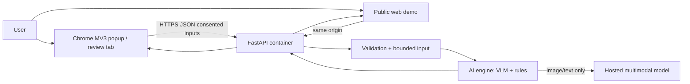

# Architecture alignment
PROPOSED • B owner • freeze 27/11 18:00 ICT

## Topology

One container serves `/`, `/downloads/extension.zip`, `/healthz`, `/api/v1/analyze`. API router B owns; A builds static demo `demo/dist/`, B packages via Docker multi-stage or copies verified dist; C owns isolated Python engine. No database/Redis on MVP; no durable scans. Stateless with bounded in-memory rate limit for one instance; multi-instance global quota not guaranteed. No microservices/queue. Synchronous request ≤25s server/provider budget; client timeout 30s. Public HTTPS required; Cloud Run or equivalent verified platform.

## Stack freeze
A: WXT + React + TypeScript, Chrome MV3; web Vite + React (reuse pure components or duplicate only minimal markup). B: Python 3.12, FastAPI/Pydantic v2/Uvicorn/Pillow, Docker, pytest/httpx; C: google-genai SDK and a supported Gemini Flash vision model (confirm model ID with real key 27/11, pin in env, do not assume availability). No extra framework unless gate approves. GitHub Actions CI. Version lockfiles committed. See research for options.

## Capture boundary
- Extension action popup opened by user grants activeTab temporarily; use chrome.tabs.captureVisibleTab(windowId, {format:'jpeg', quality:85}) only after explicit capture. Verify active tab ID/window before/after; reject non-http(s), restricted/private contexts, changed tab. Do not request all_urls, scripting, tabs, background capture. Manifest `permissions: [activeTab]`; only add storage if necessary for short-lived state; host_permissions exact API origin (localhost in dev build only). Do not capture chrome://, file:// or incognito. Use review UI in popup or extension tab; if using review tab, capture first before switching. If popup closes, discard in-memory preview (or explicit volatile session state cleared immediately on close/reset); no persistent storage. User crops/redacts and then confirms send. No content script needed.
- Preview original; crop with canvas to exclude private regions; text editable; send only approved crop. No full URL query/fragment; optionally send hostname only if visible and user approves, no navigation or DOM extraction.
- Web uses file selector/drag-drop and text. Not a background page reader. Demo fixtures hosted are synthetic, never link to real scam URLs.

## Server boundary / security
- POST JSON capped at 3 MiB HTTP body (enforce actual bytes incl chunked; reject early); decoded image ≤2 MiB, ≤2048px each dimension and ≤4M pixels; reject invalid base64, MIME mismatch, decompression bomb, animated images. Decode in Pillow, re-encode metadata-free, no temp files. Text ≤6000 chars. `Cache-Control: no-store` all analyze responses. No scans retained by app; external model processing subject to provider terms, verify data use and retention before enabling; demo only synthetic/consented sanitized content.
- CORS web same-origin, extension uses explicit backend host permission. If CORS needed for extension, allow exact verified chrome-extension://ID(s), no wildcard credentialed requests; CORS is not auth. Build unpacked extension with stable ID if needed, no private signing key in repo. Test installed release extension against public API. No raw input in logs, analytics, traces, access URLs or errors; log request id/status/elapsed/model ID only, no body. Disable debug tracebacks. Return generic errors.
- Anonymous demo (no user registration) protected by 5 scans/min/IP, 30/day/IP and max 2 concurrent calls per instance, configurable total provider daily cap/budget/alerts; test 429 Retry-After. In Cloud Run single instance/single worker for rate limiter, use trusted platform proxy identity (not arbitrary X-Forwarded-For); if cannot derive trusted IP, use global cap + concurrency, document limitation. Quota must cover judges through 11/12. Per-process limits reset on restart; don't claim production abuse resistance. Optional judge access token if costs unmanageable, documented and included in guide, never AI key in extension.
- No backend fetching/visiting user URL, no shell/eval/tools from AI output; URL display inert; no secrets in request prompt. AI output untrusted, validate enum/length; escape as text, no dangerouslySetInnerHTML. No automatic click, download, or transfer. No official brand impersonation.

## Local setup contract (to implement, not existing)
```
# root .env (gitignored); .env.example has placeholders only
AI_PROVIDER=gemini
AI_MODEL=<verified-supported-vision-model-id>
GEMINI_API_KEY=<secret>
APP_ENV=dev
PORT=8080
AI_TIMEOUT_SECONDS=20
MAX_SCANS_PER_MINUTE=5
MAX_SCANS_PER_DAY=30
MAX_CONCURRENT_SCANS=2
# root
 docker compose up --build
# extension
 cd extension && npm ci && npm run dev
# production build
 npm run build
```
B provides compose/Dockerfile, .env.example and real commands README. A uses build-time `VITE_API_BASE_URL` for extension; web demo uses relative API path. Mock mode strictly `APP_ENV=dev` and explicit UI banner; prod boot refuses mock. `/healthz` lightweight liveness, no paid model call, no credentials; readiness real scan separately.

## Deployment / release
27/11 B provision account/billing/secret; 28/11 public health; 29/11 real end-to-end. Cloud Run listens 0.0.0.0:$PORT, single worker, non-root, pinned dependencies, public invoker where allowed. Set timeout 30s, concurrency 2, max instances 1 for MVP (validate load), configure secret via Secret Manager or platform secret; budget alerts are not hard cap. Deploy tested image digest with public URL, set extension host permissions, build ZIP of unpacked dist, serve it via static download path. Avoid circular build: B deploys initial URL first, A builds extension for stable URL, B packages/downloads final release without changing URL. External browser on different network runs actual scan. If Cloud Run unavailable by 28/11 switch to pre-provisioned Docker PaaS/VPS with TLS, same contracts. Freeze image and ZIP SHA256 on 02/12; retain deployment to 11/12. Post-deadline do not change product/submission; if outage follow BTC rules and ask before restoration that changes behavior. See release checklist.
